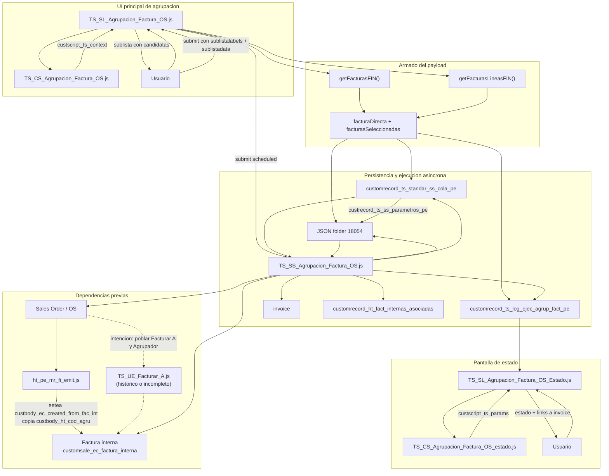

# Flujo de Agrupacion OS para Facturas

## Resumen ejecutivo

Este flujo toma facturas internas de Peru ya emitidas desde Ordenes de Servicio y permite agruparlas para generar una o varias facturas directas de cliente final. La operacion se divide en dos bloques:

1. Un bloque interactivo de Suitelet + Client Script donde el usuario filtra, revisa, selecciona y confirma las facturas internas a agrupar.
2. Un bloque asincrono de cola + archivo JSON + Scheduled Script que crea la factura directa, actualiza vinculos y deja trazabilidad de la ejecucion.

Ademas existe una pantalla separada para monitorear el estado de las ejecuciones. El repo tambien contiene piezas upstream y una variante Map/Reduce que ayudan a entender el flujo completo, aunque no forman parte estricta del camino principal pedido.

## Alcance revisado

### Flujo principal

- `src/FileCabinet/SuiteScripts/Evol/PE/Customizaciones/Agrupacion OS para Facturas/TS_SL_Agrupacion_Factura_OS.js`
- `src/FileCabinet/SuiteScripts/Evol/PE/Customizaciones/Agrupacion OS para Facturas/TS_CS_Agrupacion_Factura_OS.js`
- `src/FileCabinet/SuiteScripts/Evol/PE/Customizaciones/Agrupacion OS para Facturas/TS_SS_Agrupacion_Factura_OS.js`
- `src/FileCabinet/SuiteScripts/Evol/PE/Customizaciones/Agrupacion OS para Facturas/TS_SL_Agrupacion_Factura_OS_Estado.js`
- `src/FileCabinet/SuiteScripts/Evol/PE/Customizaciones/Agrupacion OS para Facturas/TS_CS_Agrupacion_Factura_OS_estado.js`

### Archivos extra relevantes para completar el contexto

- `src/FileCabinet/SuiteScripts/Evol/PE/Customizaciones/Agrupacion OS para Facturas/TS_MR_Agrupacion_Factura_OS.js`
- `src/FileCabinet/SuiteScripts/Evol/PE/Customizaciones/Agrupacion OS para Facturas/TS_UE_Facturar_A.js`
- `src/FileCabinet/SuiteScripts/Desarrollo_Hunter/Hunter_Peru/appHunter/modules/Emision de Facturas Internas/Map Reduce Script/ht_pe_mr_fi_emit.js`

## Objetivo funcional del proceso

El proceso busca consolidar varias facturas internas relacionadas con Ordenes de Servicio en una factura directa comercial. Para eso:

- filtra facturas internas elegibles,
- agrupa lineas por `custbody_ht_facturar_a`,
- crea una factura directa por grupo,
- enlaza la factura directa con la factura interna y con la Sales Order origen,
- registra la ejecucion para seguimiento posterior.

## Registros, campos e interfaces que participan

### Registros

- `customsale_ec_factura_interna`: factura interna origen.
- `invoice`: factura directa creada por el proceso.
- `salesorder`: Orden de Servicio vinculada a la factura interna por `custbody_ec_created_from_fac_int`.
- `customrecord_ts_standar_ss_cola_pe`: cola de ejecucion asincrona.
- `customrecord_ts_log_ejec_agrup_fact_pe`: log de cabecera y avance de la ejecucion.
- `customrecord_ht_fact_internas_asociadas`: relacion entre factura directa y factura interna.
- `customrecord_pe_concept_detraction`: configuracion de detraccion.
- `customrecord_pe_serie`: series disponibles por ubicacion y tipo de documento.

### Campos relevantes

- `custbody_ht_facturar_a`: cliente facturable real de la factura interna.
- `custbody_ht_cod_agru`: agrupador que sirve como criterio de negocio y trazabilidad.
- `custbody_ec_created_from_fac_int`: Sales Order origen de la factura interna.
- `custbody_ht_factura_directa`: enlace a la factura directa desde la factura interna y tambien desde la Sales Order.
- `custcol_ht_fac_agru`: marca por linea para indicar que ya fue agrupada.
- `custbody_ht_status_process_group`: estado de proceso del documento directo creado.
- `custrecord_ts_fact_direct_pe`: factura directa resultante guardada en el log.
- `custrecord_ts_ss_parametros_pe`: archivo JSON asociado a la cola.

### Interfaces y payloads

- `custscript_ts_context`: contexto serializado en JSON desde el Client Script al Suitelet principal.
- `custscript_ts_params`: contexto serializado en JSON desde el Client Script de estado al Suitelet de estado.
- `sublistalabels` y `sublistadata`: payload estandar que NetSuite envia al hacer submit del Suitelet con sublista.
- Archivo JSON en folder `18054`: snapshot de la ejecucion usado por el Scheduled Script.

## Flujo end-to-end por etapas

## 1. Datos previos requeridos en la factura interna

Antes de que el flujo de agrupacion pueda funcionar, la factura interna ya debe existir y traer como minimo estos datos bien poblados:

- `custbody_ec_created_from_fac_int`: referencia a la Sales Order de origen.
- `custbody_ht_facturar_a`: cliente al que realmente se debe facturar.
- `custbody_ht_cod_agru`: agrupador.
- lineas de item no agrupadas aun, es decir `custcol_ht_fac_agru` vacio.

### De donde parecen venir esos datos

- En `ht_pe_mr_fi_emit.js` se ve que la factura interna emitida recibe `custbody_ec_created_from_fac_int` y tambien copia `custbody_ht_cod_agru` desde la Sales Order.
- En `TS_UE_Facturar_A.js` hay intencion de poblar `custbody_ht_facturar_a` y `custbody_ht_cod_agru` a partir de la Sales Order, pero la parte efectiva esta comentada y el archivo luce incompleto o historico.

Conclusion: para el flujo actual, la dependencia upstream mas confiable dentro del repo es el proceso de emision de factura interna, no el User Event `TS_UE_Facturar_A.js`.

## 2. UI de busqueda y recarga del Suitelet principal

El usuario entra al Suitelet `TS_SL_Agrupacion_Factura_OS.js`, que construye el formulario principal y enlaza el Client Script `TS_CS_Agrupacion_Factura_OS.js`.

### Que hace el Suitelet principal

- Crea filtros de busqueda: cliente, rango de fechas, moneda, tipo de documento, cuenta AR, agrupador, facturar a y articulo.
- Cuando recibe `custscript_ts_context.flag = "searchFacturaFin"`, agrega campos adicionales de localizacion y facturacion PE: oficina, serie, forma de pago, tipo de operacion, concepto de detraccion, termino de pago y transferencia gratuita.
- Ejecuta `getFacturasFIN(...)` para traer facturas internas elegibles y poblar la sublista.

### Criterios de elegibilidad de la busqueda

La busqueda de `getFacturasFIN(...)` filtra transacciones de tipo `CuTrSale112` y exige, entre otras cosas:

- rango de fechas,
- moneda,
- monto distinto de cero,
- `memomain` distinto de `VOID`,
- que exista item,
- `custcol_ht_fac_agru` vacio,
- subsidiaria `3`,
- tipo de documento del `Facturar A` compatible con el tipo de documento elegido,
- filtros opcionales por cliente, agrupador, facturar a y articulo.

### Lo que se muestra al usuario

La sublista muestra la factura interna con:

- ID y numero,
- agrupador,
- OS origen,
- `custbody_pe_orden_servicio`,
- articulo,
- cuota,
- fecha,
- cliente,
- facturar a,
- nota principal,
- moneda,
- base imponible,
- impuestos calculados localmente,
- total calculado localmente.

## 3. Comportamiento del Client Script principal

`TS_CS_Agrupacion_Factura_OS.js` controla la experiencia del formulario.

### Responsabilidades principales

- Detecta cambios de filtros.
- Si cambia la moneda, autocompleta cuenta AR por defecto:
  - moneda `1` -> cuenta `4897`
  - moneda `5` -> cuenta `4896`
- Construye el objeto `params` y recarga el Suitelet por URL resuelta con `custscript_ts_context`.
- Calcula importes acumulados cuando el usuario marca o desmarca lineas.
- Valida que haya al menos una linea seleccionada y que existan los campos obligatorios al guardar.

### Detalle del recargado

El script recarga el Suitelet en casi cualquier cambio de filtro, excepto en campos de solo soporte operativo como:

- `termino_pago`
- `glosa`
- `referencia`
- `nota_factura`
- `igv`
- `totalbody`
- `importe_total`
- `forma_pago`
- `tipo_operacion`
- `concept_detraction`
- `gratutita`
- `account`

Esto significa que la sublista se recalcula del lado servidor a medida que cambian los criterios de busqueda.

## 4. Seleccion de lineas y armado del payload de ejecucion

Cuando el usuario hace submit, el mismo Suitelet `TS_SL_Agrupacion_Factura_OS.js` procesa el `POST`.

### Como toma las lineas seleccionadas

- Lee `sublistalabels` y `sublistadata`.
- Filtra las filas que empiezan con `T`, es decir, las marcadas por el usuario.
- Reconstruye objetos para cada fila seleccionada.
- Extrae los IDs de factura interna seleccionados.

### Como reconstruye la data real de backend

El Suitelet no confia solo en lo que viene de la pantalla. Luego vuelve a consultar:

- `getFacturasFIN(...)` para la cabecera de las facturas internas seleccionadas.
- `getFacturasLineasFIN(...)` para traer las lineas reales de item que se van a agrupar.

### Regla de agrupacion

Las lineas se agrupan por `custbody_ht_facturar_a`. Dentro de cada grupo:

- consolida items iguales,
- usa `custitem_ec_item_agrupado` si existe como item final,
- acumula cantidad cuando coinciden item, price, rate, departamento, clase y oficina.

El resultado es un arreglo `facturaDirecta`, donde cada elemento representa una factura directa a crear.

## 5. Cola, archivo JSON y log de ejecucion

Antes de disparar el proceso asincrono, el Suitelet genera trazabilidad y persistencia intermedia.

### Log de cabecera

`createCabLog(...)` crea un registro en `customrecord_ts_log_ejec_agrup_fact_pe` con:

- estado `pendiente`,
- porcentaje `0%`,
- cliente,
- agrupador,
- fecha de inicio,
- usuario creador.

### Cola de ejecucion

`agregarCola(...)` crea un registro en `customrecord_ts_standar_ss_cola_pe` con:

- nombre `Agrupacion Factura OS`,
- estado `pendiente`,
- creador,
- fecha de inicio.

### Archivo JSON

`saveJson(...)` guarda en folder `18054` un archivo tipo `lote{recordColaId}_{ddmmyyyy}.json` con todo el payload:

- filtros,
- usuario,
- log,
- facturas seleccionadas,
- agrupacion final `facturaDirecta`,
- datos PE de la factura directa.

Luego el Suitelet graba el `fileId` en `custrecord_ts_ss_parametros_pe` del registro de cola y dispara el Scheduled Script.

## 6. Procesamiento asincrono del Scheduled Script

`TS_SS_Agrupacion_Factura_OS.js` es el backend principal del flujo pedido.

### Paso 1. Toma una cola pendiente

`getCola()` busca en `customrecord_ts_standar_ss_cola_pe` todos los registros con estado `pendiente`, los ordena por fecha de inicio y toma el primero.

### Paso 2. Carga el JSON asociado

Con el `fileId` guardado en la cola, el script hace `file.load(...)`, parsea el JSON y obtiene:

- `facturasSeleccionadas`,
- `facturaDirecta`,
- parametros comerciales,
- datos de facturacion PE,
- `id_log`.

### Paso 3. Genera una o varias facturas directas

`generarFacturaDirecta(...)` recorre `params.facturaDirecta` y por cada grupo crea una `invoice`.

#### Datos de cabecera que setea

- formulario `183`
- cliente `entity = facturar_a`
- fecha actual
- memo = glosa
- department y class de la primera linea, si existen
- location
- `approvalstatus = 2`
- moneda
- `custbody_pe_document_type`
- `terms`
- `custbodyec_nota_cliente`
- `custbody_ht_status_process_group = 3`
- `custbody_pe_ei_forma_pago`
- `custbody_pe_concept_detraction`
- `custbody_pe_ei_operation_type`
- `custbody_pe_serie`
- `custbody_ht_cod_agru` si llego agrupador

Si `gratutita != 'F'`, tambien marca operacion gratuita y usa el item de descuento `47451`.

#### Datos por linea

Por cada item:

- usa `item_f` si existe; si no, usa el item original,
- setea unidad, cantidad, nivel de precio y tarifa,
- hereda department, class y location por linea,
- si hay detraccion, calcula codigo y montos de withholding en campos `custcol_4601_*`.

### Paso 4. Actualiza registros origen

Por cada factura interna seleccionada:

- carga la `customsale_ec_factura_interna`,
- compara `custbody_ht_facturar_a` con el grupo actual,
- setea `custbody_ht_factura_directa` en la factura interna,
- intenta setear `custbody_ht_factura_directa` en la Sales Order origen,
- crea un registro en `customrecord_ht_fact_internas_asociadas`,
- marca en la sublista de items de la factura interna la columna `custcol_ht_fac_agru` con el ID de la factura directa.

### Paso 5. Cierra log, regraba JSON y relanza

Al terminar:

- actualiza el log a `Finalizado`,
- guarda `custrecord_ts_fact_direct_pe`,
- marca fecha fin,
- actualiza la cola a `Completado`,
- regraba un JSON con `facturaDirectaid`,
- vuelve a disparar otro Scheduled para seguir procesando pendientes.

## 7. Pantalla de estado y monitoreo

El monitoreo vive en `TS_SL_Agrupacion_Factura_OS_Estado.js` con apoyo de `TS_CS_Agrupacion_Factura_OS_estado.js`.

### Suitelet de estado

- Muestra filtros `Fecha Desde` y `Fecha Hasta`.
- Consulta `customrecord_ts_log_ejec_agrup_fact_pe` mediante `getEjecuciones(...)`.
- Llena una sublista con:
  - ID,
  - estado,
  - porcentaje,
  - cliente,
  - agrupador,
  - factura directa,
  - fecha inicio,
  - fecha fin,
  - creado por,
  - errores.

Si el log trae facturas directas, arma links HTML con `url.resolveRecord(...)` hacia la `invoice`.

### Client Script de estado

- Observa cambios en `custpage_fechadesde` y `custpage_fechahasta`.
- Formatea las fechas.
- Recarga el Suitelet de estado con `custscript_ts_params`.

## Explicacion por archivo

### `TS_SL_Agrupacion_Factura_OS.js`

Disparador:

- Suitelet manual.

Recibe:

- `custscript_ts_context` cuando la pagina se recarga por filtros.
- `sublistalabels` y `sublistadata` cuando el usuario hace submit.

Consulta:

- cuentas AR,
- ubicaciones,
- series,
- facturas internas candidatas,
- lineas reales de facturas internas.

Transforma:

- filtra candidatas,
- agrupa lineas por `Facturar A`,
- consolida payload de ejecucion.

Persiste:

- log de cabecera,
- cola,
- archivo JSON,
- referencia al archivo en la cola.

Dispara despues:

- `customscript_ts_ss_agrupacion_factura_pe`.

### `TS_CS_Agrupacion_Factura_OS.js`

Disparador:

- cambios en la pagina del Suitelet principal.

Recibe:

- valores actuales del formulario y de la sublista.

Consulta:

- no consulta backend directamente; resuelve URL del Suitelet.

Transforma:

- normaliza el contexto para recarga,
- calcula importes visibles,
- autoselecciona cuenta AR por moneda.

Persiste:

- no persiste registros.

Dispara despues:

- recarga del Suitelet principal o submit del formulario.

### `TS_SS_Agrupacion_Factura_OS.js`

Disparador:

- Scheduled Script.

Recibe:

- toma la cola pendiente y el JSON asociado.

Consulta:

- cola,
- configuracion de detraccion,
- factura interna origen,
- Sales Order origen.

Transforma:

- convierte grupos de facturas internas en facturas directas.

Persiste:

- `invoice`,
- cambios en factura interna,
- cambios en Sales Order,
- `customrecord_ht_fact_internas_asociadas`,
- log de ejecucion,
- cola,
- nuevo JSON con resultado.

Dispara despues:

- otro Scheduled para continuar con pendientes.

### `TS_SL_Agrupacion_Factura_OS_Estado.js`

Disparador:

- Suitelet manual para monitoreo.

Recibe:

- `custscript_ts_params`.

Consulta:

- `customrecord_ts_log_ejec_agrup_fact_pe`.

Transforma:

- convierte IDs de factura directa en links navegables.

Persiste:

- no persiste registros.

Dispara despues:

- ninguno.

### `TS_CS_Agrupacion_Factura_OS_estado.js`

Disparador:

- cambio en fechas del monitoreo.

Recibe:

- valores de `custpage_fechadesde` y `custpage_fechahasta`.

Consulta:

- no consulta backend directamente; resuelve URL del Suitelet de estado.

Transforma:

- serializa las fechas en `custscript_ts_params`.

Persiste:

- no persiste registros.

Dispara despues:

- recarga del Suitelet de estado.

## Diagrama Mermaid

## Archivos extra necesarios para entender el flujo completo

## 1. `TS_MR_Agrupacion_Factura_OS.js`

Este archivo no fue parte del flujo principal pedido, pero es importante porque muestra una evolucion del backend asincrono:

- cambia el tipo de script a Map/Reduce,
- recibe `fileId` y `logId` como parametros explicitos,
- puede reconstruir `facturaDirecta` si solo recibe `selectedIds`,
- agrega `customrecord_ht_pe_os_inv` para vincular Sales Order e invoice,
- corrige algunos puntos que en el Scheduled estan fragiles.

Lectura recomendada: usarlo como referencia de hacia donde quiso evolucionar el proceso.

## 2. `TS_UE_Facturar_A.js`

Es relevante solo como contexto historico:

- intenta lookup a Sales Order usando `custbody_ec_created_from_fac_int`,
- intenta derivar `custbody_ht_facturar_a` y `custbody_ht_cod_agru`,
- la logica efectiva de seteo esta comentada o duplicada.

No parece seguro asumir que hoy sea la pieza activa que prepara la factura interna.

## 3. `ht_pe_mr_fi_emit.js`

Este archivo es clave para explicar el origen de algunos datos que la agrupacion da por sentados:

- setea `custbody_ec_created_from_fac_int` en la factura interna,
- hace lookup a la Sales Order,
- copia `custbody_ht_cod_agru` desde la Sales Order a la factura interna.

Eso explica por que el flujo de agrupacion puede luego filtrar por agrupador y enlazar de vuelta a la OS.

## Hallazgos tecnicos e inconsistencias

## 1. Naming inconsistente entre `PE` y `OS`

El nombre funcional habla de agrupacion OS, pero muchos `scriptId`, records y labels usan sufijo `PE`. Ejemplos:

- `customscript_ts_ss_agrupacion_factura_pe`
- `customrecord_ts_standar_ss_cola_pe`
- `customrecord_ts_log_ejec_agrup_fact_pe`

Esto no rompe el flujo por si mismo, pero complica rastreo y soporte.

## 2. Coexistencia de Scheduled y Map/Reduce

El repo contiene dos variantes del backend asincrono:

- `TS_SS_Agrupacion_Factura_OS.js`
- `TS_MR_Agrupacion_Factura_OS.js`

Sin metadata en `src/Objects`, no se puede confirmar cual esta desplegada realmente en la cuenta. El relato principal de este documento usa el Scheduled porque es el archivo que pediste revisar.

## 3. Posibles bugs en el Scheduled actual

### Bug 1. Campo de OS en la asociacion

En `TS_SS_Agrupacion_Factura_OS.js`, al crear `customrecord_ht_fact_internas_asociadas`, valida `creadoDesdeId` pero asigna:

- `params.facturasSeleccionadas[i].creadoDesdeId`

El objeto cargado usa `creado_desde`, no `creadoDesdeId`. Eso puede dejar `custrecord_orden_servicio` sin valor.

### Bug 2. Catch con variables inexistentes

En `taskScheduled(...)`, el bloque `catch` usa `recordIdToUpdate` y `recordId`, que no existen en el script. Si entra ahi, el manejo de error tambien falla.

### Bug 3. Escritura de respuesta antes del POST

`TS_SL_Agrupacion_Factura_OS.js` hace `scriptContext.response.writePage(form);` antes de procesar el bloque `POST`. Es una estructura poco usual y riesgosa si se espera luego hacer redirect.

### Bug 4. Constantes sin uso o confusas

En `TS_SS_Agrupacion_Factura_OS.js` hay constantes sin uso claro:

- `FORM_EC_FORMULARIO_FACTURA_VENTA`
- `TIPO_DOCUMENTO_18`
- `TIPO_DOCUMENTO_01`
- `COMPLETADO`
- `ERROR`
- `PROCESANDO`

Tambien `LOG_RECORD` apunta realmente a la cola, no al log de ejecucion.

### Bug 5. Relanzado con distintos scriptId

El Scheduled relanza dos veces con nombres distintos:

- en `execute(...)` usa `customscript_ts_ss_agrupacion_factura_pe`
- en `taskScheduled(...)` usa `customscript_ts_ss_agrupacion_factura_os`

Sin metadata desplegada no se puede saber si ambos existen, si uno es legado o si hay una mezcla accidental.

## 4. Dependencia fuerte de metadata no versionada

`src/Objects` esta vacio en este repo. Por eso no se puede confirmar desde codigo fuente:

- si los `scriptId` y `deploymentId` del codigo coinciden con los de la cuenta,
- si todos los custom fields existen con ese mismo `scriptId`,
- si los custom records citados tienen exactamente esa estructura,
- si el tipo `CuTrSale112` corresponde hoy a la misma custom transaction.

## Escenarios de validacion cubiertos por el analisis

- Carga inicial del Suitelet sin contexto.
- Recarga por cambios de filtros.
- Seleccion manual de lineas y calculo de totales.
- Validacion de submit con campos obligatorios.
- Reconstruccion del set seleccionado desde `sublistalabels` y `sublistadata`.
- Reconsulta de cabecera y lineas reales.
- Agrupacion por `Facturar A`.
- Creacion de log, cola y JSON.
- Procesamiento asincrono de cola.
- Generacion de una o varias facturas directas.
- Actualizacion de factura interna, Sales Order y registro de asociacion.
- Consulta de estado por rango de fechas.
- Visualizacion de links hacia la factura directa.

## Que falta para tener certeza total

Para cerrar el flujo con certeza 100 por ciento, faltaria validar en la cuenta NetSuite:

- los deployments reales de los scripts,
- los script IDs efectivos,
- la definicion de `CuTrSale112`,
- la estructura de los custom records y custom fields citados,
- cual backend asincrono esta activo hoy: Scheduled o Map/Reduce,
- si `TS_UE_Facturar_A.js` esta desplegado y en que evento exacto.

Con lo que hay en el repo, el flujo funcional principal si se puede reconstruir con bastante confianza, pero la capa de metadata de cuenta queda parcialmente inferida.
